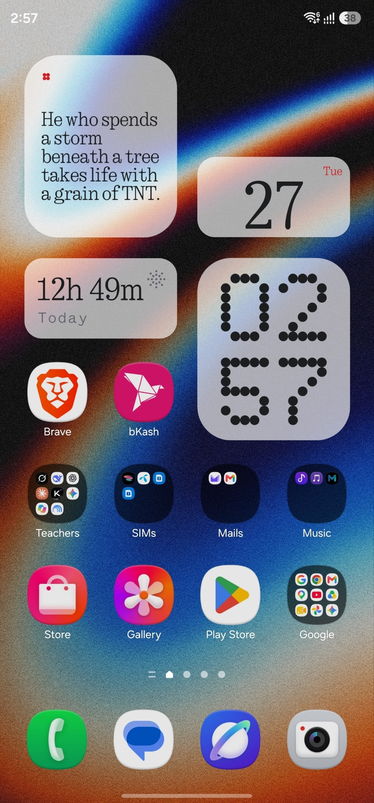
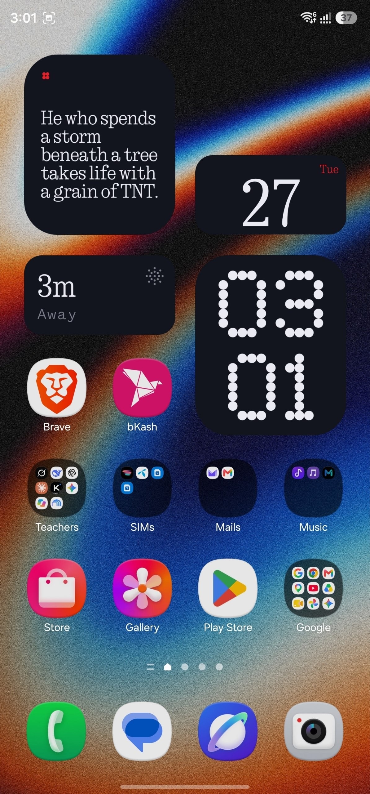
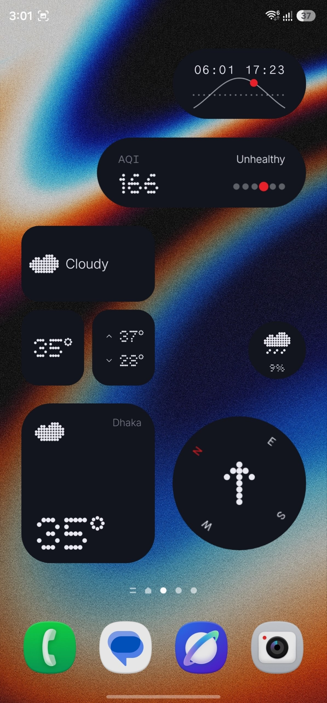
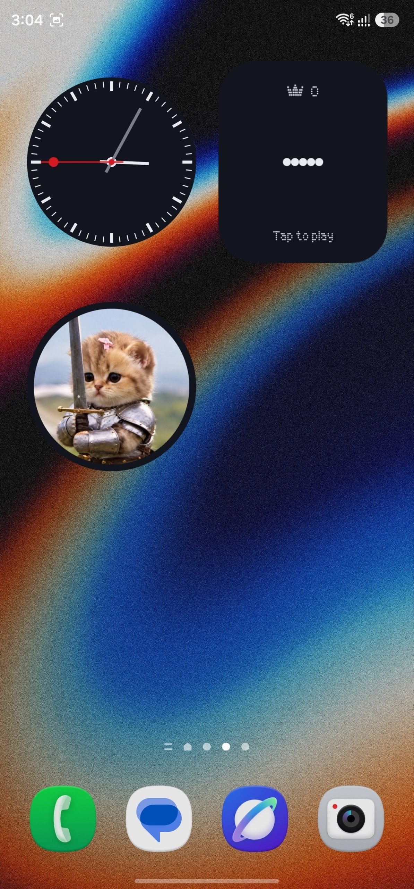
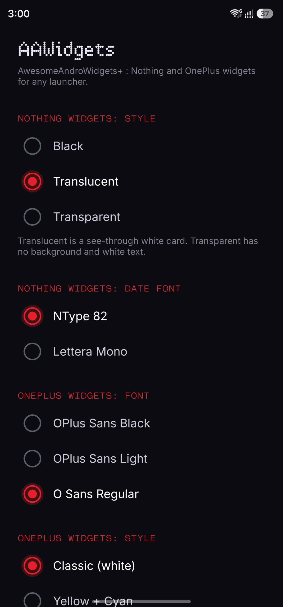
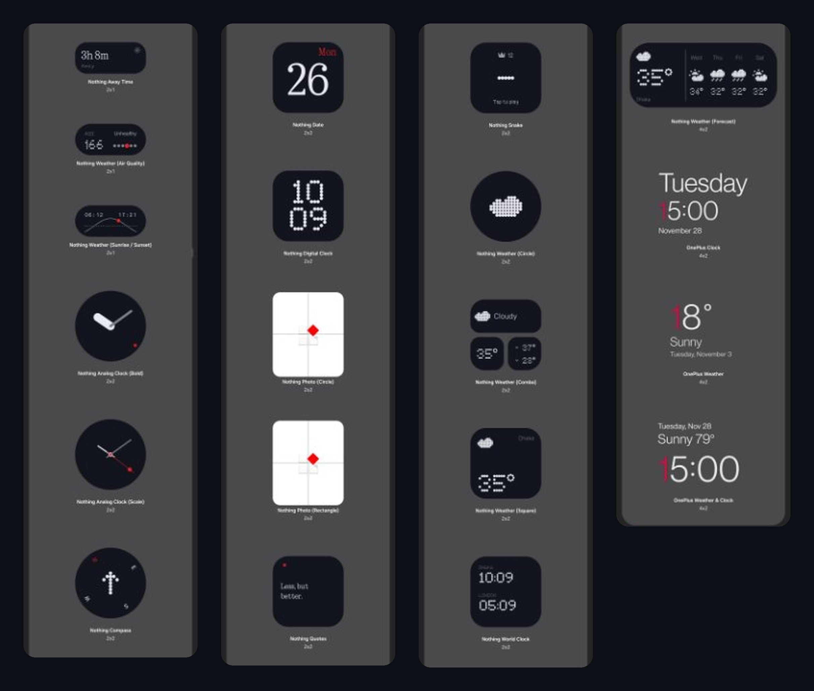
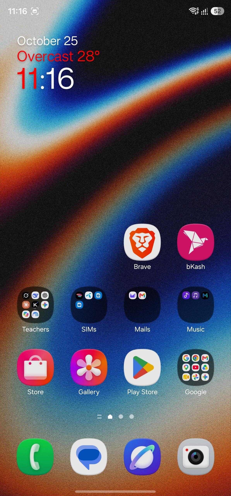
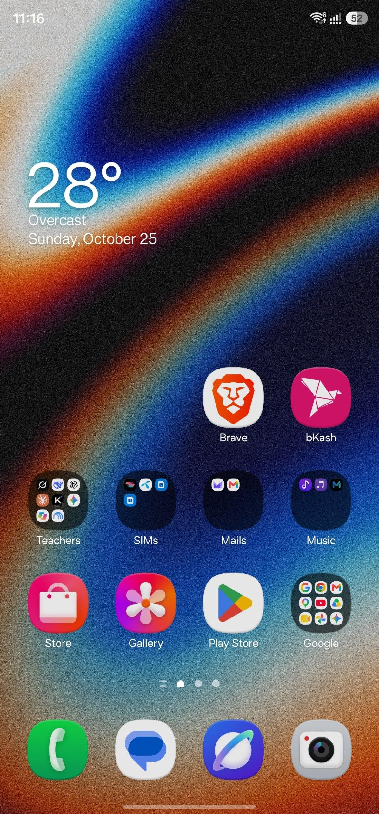

<h1 align="center">AwesomeAWidgets</h1>

  <b>AwesomeAndroWidgets+</b> — Nothing &amp; OnePlus widgets for <b>any Android launcher</b>. 
  3 original OnePlus widgets with tons of mods, plus 23 Nothing widgets to pick from.

  
  
  
  
  
  
  
  
  
  
  

  <a href="#screenshots">Screenshots</a> ·
  <a href="#features">Features</a> ·
  <a href="#install">Install</a> ·
  <a href="#settings">Settings</a> ·
  <a href="#community--support">Community</a> ·
  <a href="#star-history">Stargazers</a> ·
  <a href="#sponsors">Sponsors</a>

  
  
  

## Features

### OnePlus widgets (original, with tons of mods)

- **3 widgets**: *OnePlus Clock*, *OnePlus Weather* and *OnePlus Weather &amp; Clock*.
- **Android 6.0+** (minSdk 23), works on any launcher.
- **Real OnePlus red "1"** in the clock hour and the temperature.
- **Always red hour digit** (optional): turns the last hour digit red (01 … 12) instead of only the 1.
- **Alignment and widget space fixed**: resize them perfectly.
- **Fonts you can choose**: OPlus Sans Black, OPlus Sans Light, O Sans Regular.
- **Styles**: Classic (white), Cyberpunk (yellow + cyan glow), Neon Cyan, Neon Purple, Neon Green.
- **"Never Settle" text**: show or hide it, red by default.
- **Built-in weather**: no OnePlus Weather app and no API key. Pick your city in the app. Data comes from [Open-Meteo](https://open-meteo.com), with °C / °F.

### Nothing widgets

- **23 Nothing widgets to choose from**: weather (circle, square, combo, forecast, air quality, sunrise / sunset), analog &amp; digital clocks, world clock, away time, date, compass, photo (circle / rectangle), quotes and Snake.
- **Widget style**: Black, Translucent (see-through white card) or Transparent (no background, white text).
- **Date font**: NType 82 or Lettera Mono.

## Screenshots

### Nothing widgets

  
  

### Every widget in the picker

  

### OnePlus widgets

  
  
  
  

## Install

1. Download the latest APK from [Releases](https://github.com/SameerAlSahab/AwesomeAWidgets/releases).
2. Install it and open **AAWidgets**.
3. Search for your city under **Weather area** and pick it.
4. Long-press your home screen, open **Widgets**, find **AAWidgets** and add any Nothing or OnePlus widget.

## Settings

| Option | What it does |
|---|---|
| Nothing widgets: Style | Black, Translucent or Transparent. |
| Nothing widgets: Date font | NType 82 or Lettera Mono. |
| OnePlus widgets: Font | OPlus Sans Black, OPlus Sans Light or O Sans Regular. |
| OnePlus widgets: Style | Classic (white), Cyberpunk, Neon Cyan, Neon Purple or Neon Green. |
| Always red hour digit | Off: only a 1 is red (stock OnePlus). On: the last hour digit is always red. |
| Show "Never Settle" | Shows the slogan when there is no weather line. |
| "Never Settle" in red | Red slogan (default) or follow the style colour. |
| Weather area / °F | City search and temperature unit. |

## Community &amp; Support

- 💬 **[Discussions](https://github.com/SameerAlSahab/AwesomeAWidgets/discussions)**: questions, ideas, show off your setup.
- 🐞 **[Issues](https://github.com/SameerAlSahab/AwesomeAWidgets/issues)**: bug reports and feature requests.
- 📣 **[Telegram @apcports2](https://t.me/apcports2)**: updates and ports.

## Star History

If you like the project, a ⭐ on the [stargazers page](https://github.com/SameerAlSahab/AwesomeAWidgets/stargazers) helps a lot.

<a href="https://star-history.com/#SameerAlSahab/AwesomeAWidgets&Date">
  <picture>
    <source media="(prefers-color-scheme: dark)" srcset="https://api.star-history.com/svg?repos=SameerAlSahab/AwesomeAWidgets&type=Date&theme=dark" />
    <source media="(prefers-color-scheme: light)" srcset="https://api.star-history.com/svg?repos=SameerAlSahab/AwesomeAWidgets&type=Date" />
    
  </picture>
</a>

## Sponsors

AwesomeAWidgets is free and open source. If it made your home screen better, consider supporting development:

  

Thank you to everyone who sponsors or contributes. 💜

## Credits

- **[Sameer Al Sahab](https://github.com/SameerAlSahab)**: port, renderer, settings app, [AppsPorter](https://github.com/SameerAlSahab/AppsPorter)
- **OnePlus**: original widgets, OPlus Sans font and the Cyberpunk theme colours
- **Nothing**: widget design language and NType / Lettera Mono fonts
- **[Open-Meteo](https://open-meteo.com)**: free open-source weather API
- Telegram channel: [@apcports2](https://t.me/apcports2)

## Disclaimer

This is an unofficial community project and is not affiliated with or endorsed by OnePlus or Nothing. Brand names, widget designs and fonts belong to their owners.

## License

Released under the [MIT License](LICENSE).
