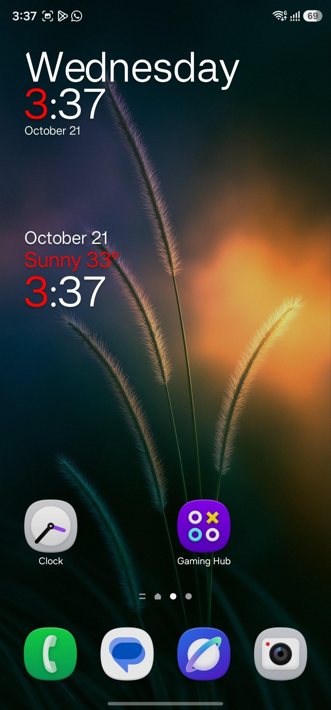
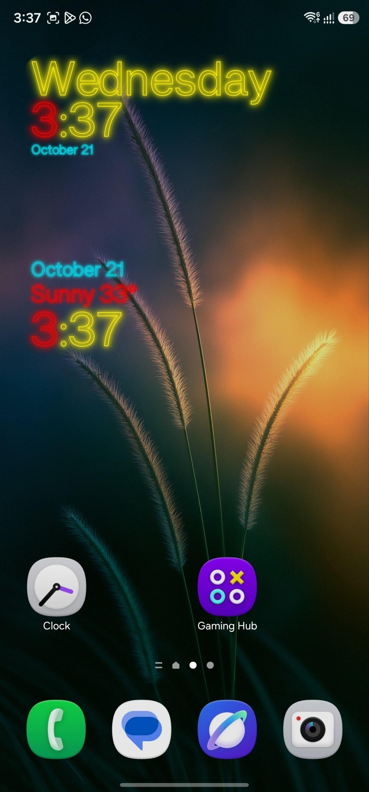
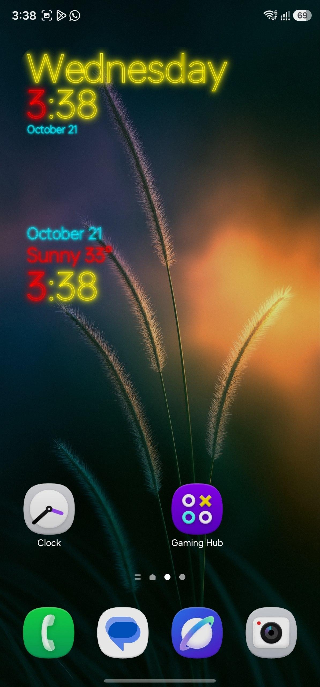
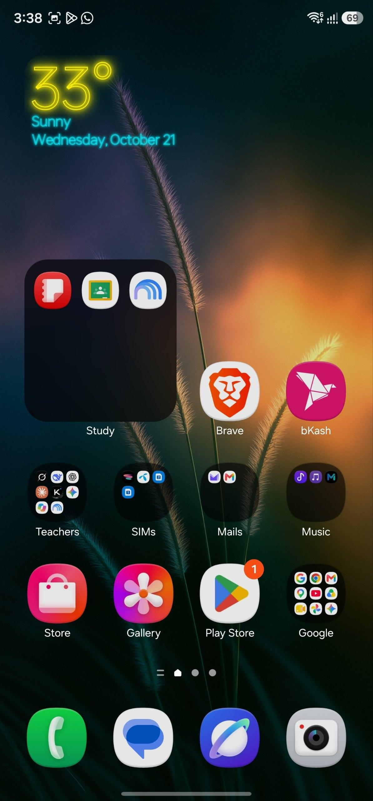
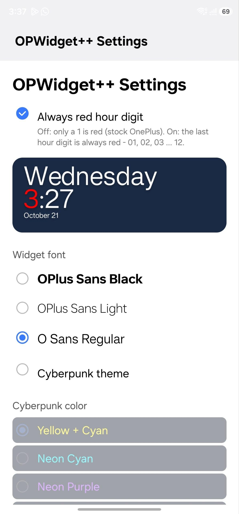
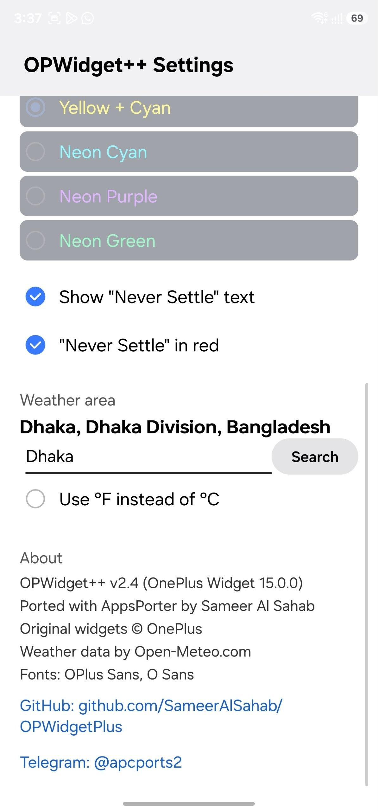

<h1 align="center">OPWidgetPlus</h1>

  The OnePlus clock &amp; weather widgets, ported to <b>every Android launcher</b> (Android 6.0+), 
  with the real red "1", custom fonts, neon Cyberpunk glow and no OnePlus Weather dependency.

  
  
  
  
  
  
  
  
  

  
  
  
  
  
  

## Features

- **Works in any launcher** - Pixel, Samsung, Xiaomi, Nova, Lawnchair and more. The widget is drawn as an image, so no OnePlus launcher classes are needed.
- **Android 6.0+** (minSdk 23).
- **Real OnePlus red "1"** in the clock hour and the temperature.
- **Three widgets**: Clock, Weather, and Weather &amp; Clock.
- **Fonts you can choose**: OPlus Sans Black, OPlus Sans Light, O Sans Regular.
- **Styles**: Classic, Cyberpunk (yellow + cyan glow), Neon Cyan, Neon Purple, Neon Green.
- **Cyberpunk RGB animation** - a smooth 5 second colour flow after you unlock (can be turned off).
- **"Never Settle" text** - show or hide it, red by default.
- **Always red hour digit** (optional) - turns the last hour digit red (01, 02, 03 ... 12) instead of only the 1.
- **Built-in weather** - no OnePlus Weather app and no API key. Pick your city in the app. Data comes from [Open-Meteo](https://open-meteo.com), with °C / °F.

## Install

1. Download the latest APK from [Releases](https://github.com/SameerAlSahab/OPWidgetPlus/releases).
2. Install it and open **OPlus_Widgets Settings**.
3. Search for your city under **Weather area** and pick it.
4. Long-press your home screen, open **Widgets**, and add *OnePlus Clock*, *OnePlus Weather* or *OnePlus Weather &amp; Clock*.

## Settings

| Option | What it does |
|---|---|
| Always red hour digit | Off: only a 1 is red (stock OnePlus). On: the last hour digit is always red. |
| Widget font | Choose between the three bundled fonts. |
| Style | Classic or one of the glowing neon styles. |
| RGB animation | Colour flow after unlock, for the glowing styles. |
| Show "Never Settle" | Shows the slogan when there is no weather line. |
| "Never Settle" in red | Red slogan (default) or follow the style colour. |
| Weather area / °F | City search and temperature unit. |

## How it works

The original OnePlus widget uses custom views and font resources that only the OnePlus launcher can load. OPWidgetPlus replaces that with a small renderer that draws the text into a bitmap with your chosen font, then shows it in a plain `ImageView`. An alarm refreshes it every minute, and weather is refreshed every 30 minutes.

Ported from the OnePlus Widget APK (`net.oneplus.widget` 15.0.0) with [AppsPorter](https://github.com/SameerAlSahab/AppsPorter).

## Credits

- **[Sameer Al Sahab](https://github.com/SameerAlSahab)** - port, renderer, settings app, [AppsPorter](https://github.com/SameerAlSahab/AppsPorter)
- **OnePlus** - original widgets, OPlus Sans font and the Cyberpunk theme colours
- **[Open-Meteo](https://open-meteo.com)** - free open-source weather API
- Telegram channel: [@apcports2](https://t.me/apcports2)

## Disclaimer

This is an unofficial community project and is not affiliated with or endorsed by OnePlus. OnePlus names, widget designs and fonts belong to their owners.

## License

Released under the [MIT License](LICENSE).# OPWidgetPlus
OnePlus OG Widget with tons of mods for any Android device 6.0++
